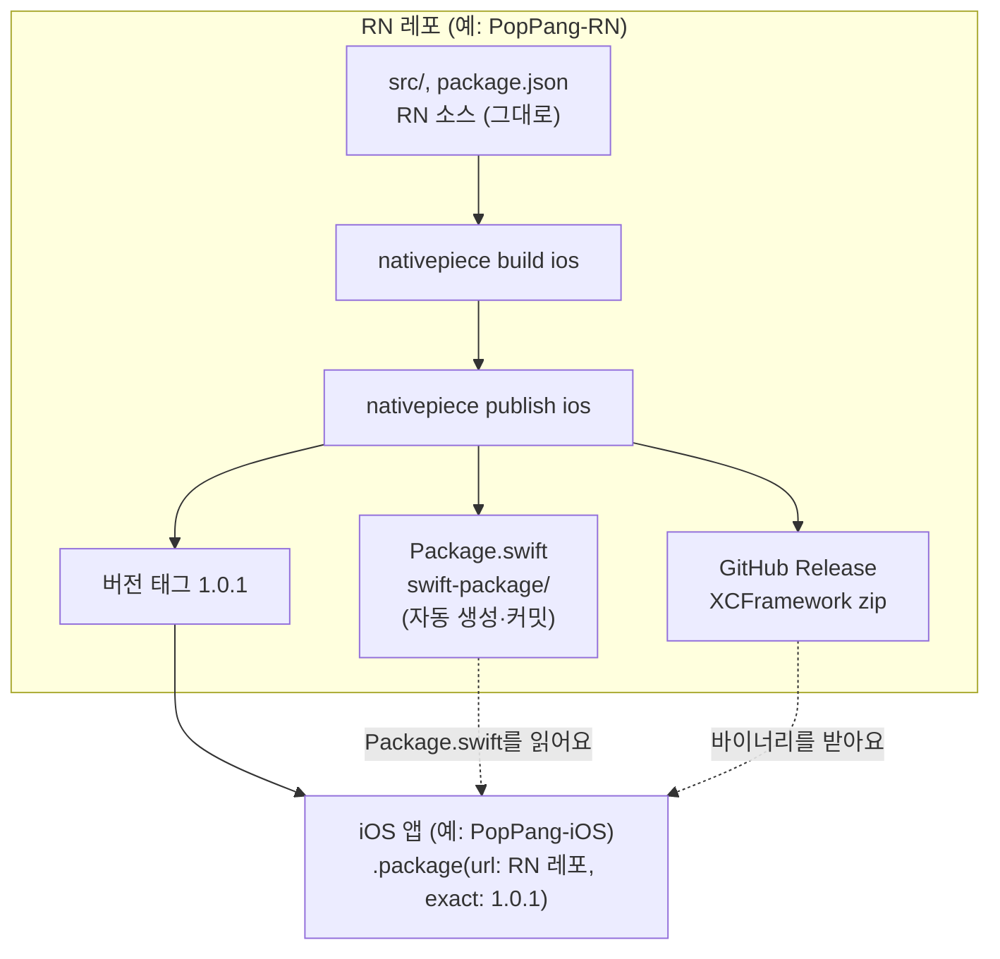
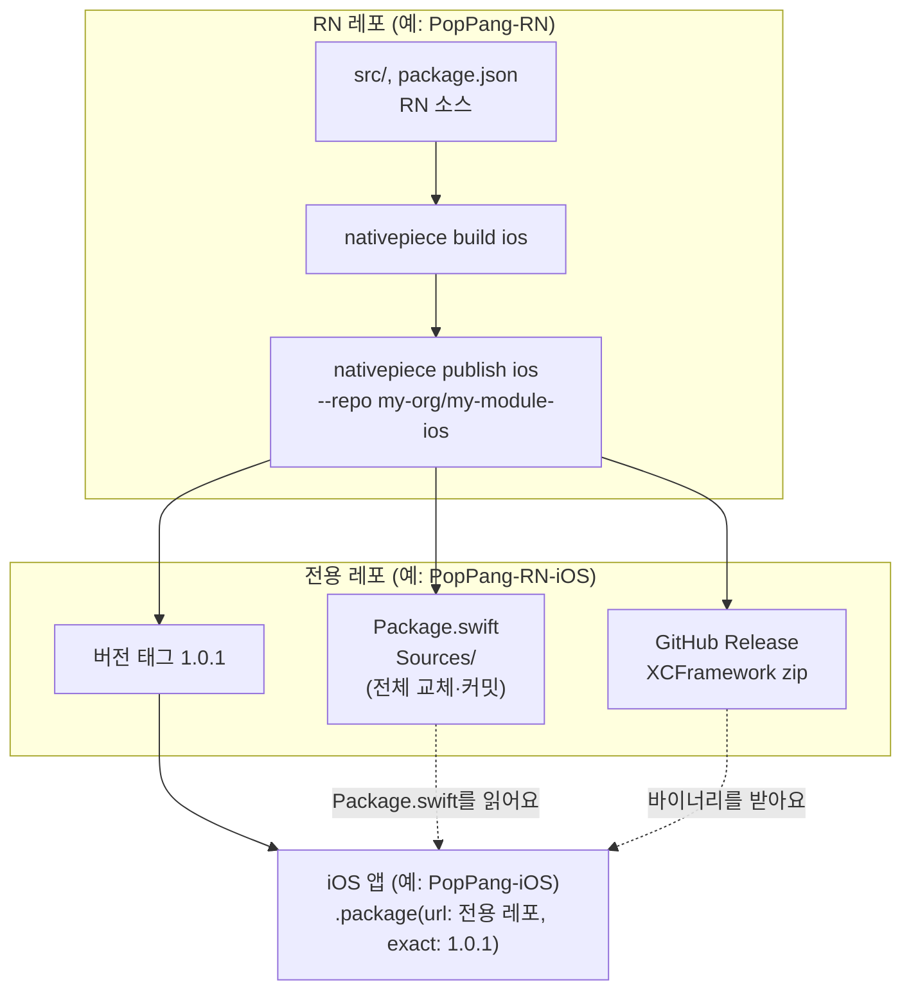

# Nativepiece

React Native 앱을 모듈로 만들어 Swift(iOS)와 Kotlin(Android) 네이티브 앱에서 의존성 하나로 쓰게 해 주는 도구예요.

- iOS: Swift Package 하나 (XCFramework, 호스트 SDK, Hermes 바이트코드 번들 포함)
- Android: Maven 의존성 하나 (SDK AAR, 네이티브 모듈 AAR, Compose용 artifact)
- 앱과 RN이 주고받는 것을 TS 계약 파일로 정의하면, Swift·Kotlin 타입이 생성돼요.

자세한 설계는 [테크 스펙](docs/tech-spec.md)을 봐 주세요.

## 시작하기

### 설치 준비 (한 번만)

Nativepiece 패키지는 GitHub Packages(team-PopPang 조직 전용)에 있어요. `read:packages` 권한이 있는 GitHub 토큰을 사용자 `~/.npmrc`에 넣어 주세요.

```
@team-poppang:registry=https://npm.pkg.github.com
//npm.pkg.github.com/:_authToken=<GitHub 토큰>
```

`gh`를 쓰고 있다면 `gh auth refresh -s read:packages`로 권한을 추가한 뒤 `gh auth token` 값을 넣으면 돼요. CI에서는 `NODE_AUTH_TOKEN` 환경 변수로 넣어요.

### 새 모듈 앱 만들기

```bash
npm init @team-poppang/nativepiece my-module -- --group com.example
cd my-module
npm run build:ios       # .nativepiece/output/ios/MyModule
npm run build:android   # .nativepiece/output/android/maven
```

`--rn 0.88`처럼 React Native 버전을 고를 수 있어요(검증한 버전: 0.84~0.88). 만들어진 프로젝트에는 SwiftUI(`example/ios`)와 Jetpack Compose(`example/android`) 예제 호스트 앱이 들어 있어요.

### 기존 RN 앱을 모듈로 만들기

```bash
cd my-rn-app
npm install -D @team-poppang/nativepiece-cli
npx nativepiece init     # 설정, 계약, 진입점 파일을 만들어요. ios/, android/, 앱 소스는 건드리지 않아요
npm install
npx nativepiece doctor
npx nativepiece build ios
```

## 계약

```ts
// nativepiece.contract.ts
export default defineContract({
  screens:  { request: screen<{ userUuid: string }>() },
  events:   { requestSubmitted: event<{ requestId: string }>() },   // RN → 앱
  calls:    { getAccessToken: call<void, { token: string }>() },   // RN → 앱 → RN
  messages: { userChanged: message<{ userUuid: string }>() },       // 앱 → RN
});
```

```swift
// iOS
final class AppBridge: MyModuleHost {
    func getAccessToken() async throws -> MyModule.GetAccessTokenResponse { .init(token: token) }
}
MyModule.start(host: AppBridge())

NativepieceView(MyModule.Screen.request(.init(userUuid: id)))
    .onEvent(MyModule.Event.self) { event in ... }
```

```kotlin
// Android
MyModule.start(application, AppBridge())

MyModuleScreen(
    screen = MyModule.Screen.Request(MyModule.RequestProps(userUuid = id)),
    onEvent = { event -> ... },
)
```

## 명령

| 명령 | 하는 일 |
|---|---|
| `npm init @team-poppang/nativepiece <dir>` | 새 모듈 앱을 만들어요 |
| `nativepiece init` | 기존 RN 앱에 Nativepiece 설정을 추가해요 |
| `nativepiece doctor` | 프로젝트, 계약, 개발 환경을 점검해요 |
| `nativepiece codegen` | 계약에서 Swift·Kotlin 코드를 만들어요 (`.nativepiece/codegen`) |
| `nativepiece build ios [--dev]` | Swift Package를 만들어요. `--dev`는 Metro와 Fast Refresh를 쓰는 개발용이에요 |
| `nativepiece build android` | Maven 저장소를 만들어요 |
| `nativepiece dev` | Metro 개발 서버를 띄워요 |
| `nativepiece publish ios [--repo owner/name] [--dry-run]` | Swift Package를 배포해요. `--repo`가 없으면 지금 레포에 배포해요 ([iOS 배포](#ios-배포)) |
| `nativepiece publish android [--url <maven url>] [--dry-run]` | 빌드한 Maven 저장소의 artifact를 원격 Maven 저장소에 올려요 |

## iOS 배포

iOS 앱은 Xcode에서 레포 URL로 Swift Package를 추가해요. Xcode는 레포 **루트**의 `Package.swift`를 읽어요. 그래서 `Package.swift`를 어느 레포에 둘지에 따라 배포 방식이 두 가지예요.

| | 같은 레포 모드 (기본) | 전용 레포 모드 |
|---|---|---|
| 언제 쓰나요 | RN 레포 하나만 관리하고 싶을 때 | iOS 결과물을 RN 소스와 분리하고 싶을 때 |
| 설정 | `publish.ios.repo`를 넣지 않아요 | `publish.ios.repo`에 다른 레포를 넣어요 |
| `Package.swift` 위치 | RN 레포 루트 | 전용 레포 루트 |
| 레포에서 바뀌는 파일 | `Package.swift`, `swift-package/`, `.gitignore`만 | 전용 레포의 모든 파일 |
| 앱에서 추가할 URL | RN 레포 | 전용 레포 |
| 필요한 레포 | 1개 | 2개 |

### 같은 레포 모드

RN 레포에서 실행하면 그 레포(git `origin`)에 바로 배포해요. RN 소스는 건드리지 않고, 레포 루트의 `Package.swift`와 RN 프로젝트 안의 `swift-package/` 폴더만 커밋해요.



```bash
npx nativepiece build ios
npx nativepiece publish ios       # --repo 없이 실행해요
```

배포 전에 아래 조건을 확인하고, 하나라도 맞지 않으면 아무것도 바꾸지 않고 멈춰요.

- 커밋하지 않은 변경이 없어요. 배포 커밋에 다른 변경이 섞이지 않게 해요.
- 기본 브랜치(main)에 있고, 로컬과 `origin`이 같아요.
- 레포 루트에 Nativepiece가 만들지 않은 `Package.swift`가 없어요.

Swift 소스 폴더 이름은 `publish.ios.packageDir`로 바꿀 수 있어요(기본값 `swift-package`). RN 프로젝트가 레포 하위 폴더에 있어도 `Package.swift`는 git 루트에 만들어요.

### 전용 레포 모드

`publish.ios.repo`(또는 `--repo`)에 다른 레포를 넣으면 그 레포를 Swift Package 전용으로 써요. 배포할 때마다 전용 레포의 내용을 이번 버전의 `Package.swift`와 소스로 **모두 바꿔요.**



```ts
// nativepiece.config.ts
publish: {
  ios: { repo: 'my-org/my-module-ios' },
},
```

전용 레포 루트에 `package.json`이 있거나 Nativepiece가 만들지 않은 `Package.swift`가 있으면 멈춰요. RN 레포를 전용 레포로 잘못 지정해 소스가 지워지는 일을 막아요. `repo`에 지금 레포를 넣으면 같은 레포 모드로 배포해요.

### 두 모드 공통

- 버전 태그는 `config.version`(기본값 `package.json`의 version)이에요. 같은 버전은 덮어쓰지 않아요. 배포할 때마다 version을 올려요.
- XCFramework는 그 태그의 GitHub Release에 zip으로 올라가요. JS 번들(`main.jsbundle`)은 Swift Package 리소스라서 레포에 커밋돼요.
- `--dry-run`을 붙이면 아무것도 올리지 않고, 배포할 파일만 `.nativepiece/publish/ios`에 만들어 보여 줘요.
- 레포가 비공개면 Xcode가 git과 바이너리를 받을 수 있게 앱 개발자 PC와 CI의 `~/.netrc`에 읽기 토큰을 넣어야 해요.

```
machine api.github.com
  login x-access-token
  password <GitHub 토큰>
machine github.com
  login x-access-token
  password <GitHub 토큰>
```

## Android 배포

```bash
npx nativepiece build android
npx nativepiece publish android --url https://maven.pkg.github.com/my-org/my-module-android
```

- 네이티브 모듈 AAR을 먼저 올리고 SDK를 마지막에 올려요. 이미 있는 SDK 버전은 덮어쓰지 않아요.
- 인증은 `NATIVEPIECE_MAVEN_USERNAME`, `NATIVEPIECE_MAVEN_PASSWORD` 환경 변수로 해요. GitHub Packages면 둘 다 없을 때 `gh` 로그인 정보를 써요. 토큰에 `write:packages` 권한이 있어야 해요.

## Nativepiece 자체 배포

Actions의 **Release → Run workflow**(또는 `gh workflow run release.yml -f bump=patch`)를 실행하면 버전 올리기, npm 패키지 3개 발행, 릴리스 노트 작성, 발행 검증까지 한 번에 해요. 자세한 내용은 [npm 패키지 만들기와 새 버전 올리기](docs/npm-packages.md)를 봐 주세요.

## 요구 사항

- React Native 0.84 이상 (New Architecture, Hermes). 0.84, 0.85, 0.86, 0.87, 0.88을 검증했어요
- Node 22.11 이상
- iOS 빌드: Xcode, CocoaPods
- Android 빌드: JDK 17, Android SDK

## 패키지

| 경로 | 패키지 |
|---|---|
| `packages/cli` | `@team-poppang/nativepiece-cli` |
| `packages/runtime` | `@team-poppang/nativepiece-runtime` (JS API와 TurboModule) |
| `packages/create-nativepiece` | `@team-poppang/create-nativepiece` (템플릿 포함) |
| `packages/ios-host` | Swift 호스트 SDK (`NativepieceKit`). 결과물 Swift Package에 소스로 들어가요 |
| `packages/android-host` | Kotlin 호스트 SDK. 결과물 SDK AAR에 들어가요 |
| `packages/android-compose` | Compose 호스트 SDK. `<artifactId>-compose`에 들어가요 |
