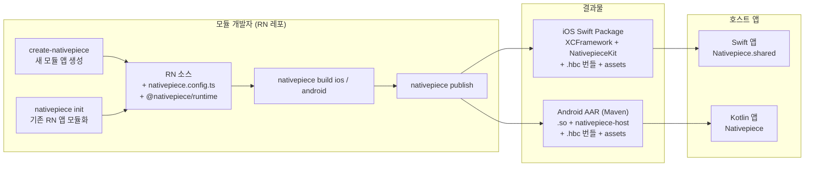

# Nativepiece 테크 스펙

React Native 앱을 모듈로 만들어 Swift(iOS)와 Kotlin(Android) 네이티브 앱에서 의존성 하나로 가져다 쓰게 해 주는 라이브러리예요.

| 항목 | 내용 |
|---|---|
| 상태 | 승인 (2026-10-18) |
| 작성일 | 2026-10-18 |
| 작성자 | dhkim@mapseacorp.com |
| 첫 적용 대상 | PopPang-RN → PopPang-iOS / PopPang Android |

---

## 1. 요약

Nativepiece는 다음 네 가지를 하나의 도구로 제공해요.

1. **모듈 앱 생성** — `npx create-nativepiece`로 바로 모듈로 빌드할 수 있는 RN 프로젝트와 테스트용 iOS·Android 호스트 앱을 함께 만들어요.
2. **모듈화(기존 RN 앱 변환)** — `npx nativepiece init`으로 이미 있는 RN 앱을 모듈로 빌드할 수 있는 상태로 바꿔요.
3. **모듈 빌드·배포** — `nativepiece build`와 `nativepiece publish`로 iOS용 Swift Package(XCFramework)와 Android용 AAR(Maven)을 만들어요.
4. **호스트 SDK** — 네이티브 앱이 RN 화면을 띄우고, 양방향으로 메시지를 주고받고, 런타임을 미리 띄우는 API를 Swift와 Kotlin에 같은 형태로 제공해요.

빌드 파이프라인은 PopPang-RN에서 이미 동작하는 코드를 설정 기반으로 일반화해서 가져와요. Android 패키징 방식과 런타임 구조는 바꿔서 성능과 결과물 크기를 개선해요.

---

## 2. 배경

### 2.1 PopPang-RN의 현재 구조

PopPang-RN(RN 0.86, New Architecture, Hermes)은 라이브러리 없이 레포 안에서 직접 iOS·Android 결과물을 만들어요.

| 영역 | 현재 방식 |
|---|---|
| JS 번들 | `react-native bundle`로 `native-entry.js`를 번들링해요. 결과는 일반 JS(약 1.3MB)이고 Hermes 바이트코드가 아니에요. |
| iOS | `react_native_prebuild/New_build_xcframeworks.sh`가 더미 앱과 CocoaPods로 XCFramework를 만들고 `Package.swift`를 생성해요. prebuilt RN core(`React.xcframework`, `ReactNativeDependencies.xcframework`, `hermesvm.xcframework`)를 사용해요. 결과물은 61MB zip이에요. |
| Android | `react_native_android_prebuild/build_aars.sh`가 데모 앱을 빌드해 `.so`를 모으고, 네이티브 모듈마다 AAR을 발행한 뒤 Gradle 캐시 전체를 미러링해요. 결과물은 697MB zip이에요. |
| 배포 | `release-rn.sh`가 GitHub Release에 zip 4개를 올려요. 기존 태그를 지우고 다시 만들어요. |
| 소비 | PopPang-iOS는 `gh release download`로 받아 로컬 SPM 패키지로 연결하고, JS 번들은 folder reference로 직접 넣어요. |
| 연동 코드 | Swift 연동 코드는 README에서 복사해 쓰고 있어요. 화면마다 `RCTReactNativeFactory`를 새로 만들어요. |
| 메시지 | 레거시 브리지 모듈 `PopPangHostAction` 하나로 RN → 앱 방향만 지원해요. 전역 handler 하나와 이벤트 화이트리스트를 써요. |

### 2.2 재사용을 막는 문제

- **이름과 값이 하드코딩돼 있어요.** `PopPang` 접두사, 모듈 이름 `PopPangRNRoot`, Maven 좌표 `com.poppang`, iOS 17.0, minSdk 24, ABI 4개, GitHub 레포 이름이 스크립트와 네이티브 코드 곳곳에 박혀 있어요.
- **경로가 고정돼 있어요.** prebuild 디렉터리가 `..`을 RN 루트로 가정하고, Android 빌드는 데모 앱 `:app` 모듈이 빌드돼야 동작해요.
- **제품 이벤트가 네이티브 코드에 박혀 있어요.** Kotlin `emit`은 화이트리스트에 없는 이벤트를 조용히 버려요.
- **연동 코드가 배포되지 않아요.** 앱마다 복사해야 하고, Metro 개발 모드가 없어요.
- **RN 버전에 취약해요.** VFS 헤더 변환(`materialize_react_vfs_headers.rb`)과 `React_RCTAppDelegate` stub이 RN 0.86 내부 구조에 의존해요.

### 2.3 성능 문제

- iOS가 RN 화면을 열 때마다 런타임을 새로 띄워요.
- 미리 띄워 두는 워밍업(prewarm)이 없어요. Android도 처음 열 때 런타임을 만들어요.
- JS 번들을 Hermes 바이트코드로 컴파일하지 않아서 실행할 때 파싱 비용이 들어요.
- Android 배포 결과물이 697MB예요.

---

## 3. 목표와 비목표

### 3.1 목표

- 새 모듈 앱을 명령어 하나로 만들 수 있어요.
- 기존 RN 앱을 명령어 하나로 모듈화할 수 있어요. 기존 `ios/`, `android/` 디렉터리는 건드리지 않아요.
- iOS와 Android에 같은 개념, 같은 이름의 API를 제공해요.
- 호스트 앱 개발자는 Node, CocoaPods, RN 빌드 환경 없이 Swift Package 하나 또는 Maven 의존성 하나만 추가하면 돼요.
- 앱 이름, 이벤트, 화면 같은 제품 정보는 모두 설정과 JS 코드에서 정의해요. 네이티브 코드에 하드코딩하지 않아요.
- 화면 재진입 비용을 없애고, 첫 진입 시간과 결과물 크기를 측정 가능한 수준으로 줄여요.
- PopPang-RN을 Nativepiece로 옮겨도 기존 기능이 그대로 동작해요.

### 3.2 비목표 (1차 범위 밖)

- 여러 RN 모듈을 하나의 앱에 넣는 구조와 micro-frontend (모듈은 하나만 만들어요. 13장 참고)
- OTA 업데이트 서버 (P4에서 검토해요. 1차에서는 번들 로더를 교체할 수 있는 구조만 만들어요)
- Old Architecture 지원
- JSC 엔진 지원
- Expo 관리형 프로젝트 지원 (bare RN 우선. Expo prebuild 결과물은 P3에서 검토해요)

---

## 4. 레퍼런스 분석

| 레퍼런스 | 특징 | Nativepiece가 가져올 것 |
|---|---|---|
| **PopPang-RN** | prebuilt core 기반 XCFramework와 SPM 생성, 캐시와 롤백, Android C++ autolinking `.so` 수집 | iOS 빌드 파이프라인 전체, Android `.so` 수집 로직, JS에서 화면을 고르는 구조 |
| **토스 Granite** (`toss/granite`, v3.0.4) | 하나의 Hermes 런타임을 여러 화면이 함께 써요. `GraniteNativeFactory`(iOS), 기존 Activity에 붙이는 `GraniteReactHost` interface(Android), 교체 가능한 `BundleLoader`, `plugin-hermes`로 `.hbc` 생성, micro-frontend와 CDN 배포 | 런타임 공유 구조, Activity 상속을 강요하지 않는 Android API, `BundleLoader` 추상화, Hermes 바이트코드 단계, 이후 micro-frontend 설계 |
| **Callstack react-native-brownfield / Rock** | iOS XCFramework 패키징, Android fat AAR(RN·Hermes는 `api` 의존성으로 Maven에서 해결), transitive 의존성을 POM에 기록, `startReactNative(preloadBundle:)`, `JSBundleTimings`, `postMessage` | Android 패키징 방식, 헬퍼 프레임워크를 인터페이스만 남겨 심볼 중복 방지, 프리로드 API, 지표 API |
| **Expo brownfield** (SDK 55+) | 설정 플러그인으로 타깃 이름과 Maven 좌표 설정, iOS SwiftPM 패키지 출력, SwiftUI `ReactNativeView`, `BrownfieldActivity` | SwiftPM 출력 형태, SwiftUI 래퍼, 설정 기반 이름 지정 |
| **Re.Pack 5** | Rspack 기반 Module Federation | P4 micro-frontend 대안으로만 검토해요 |
| **RN 공식** (0.86~0.87) | `RCTReactNativeFactory`, `DefaultReactHost`, `ReactSurface.prerender()`, iOS prebuilt core 기본 사용(0.84+) | 호스트 SDK의 기반 API |

**판단:** iOS는 PopPang 파이프라인이 Callstack보다 더 다듬어져 있어서 그대로 일반화해요. Android는 Callstack의 fat AAR 방식이 결과물 크기와 의존성 관리에서 유리해서 이 방식으로 바꿔요. 런타임과 호스트 구조는 Granite를 따라요.

---

## 5. 전체 아키텍처



### 5.1 핵심 결정

| 결정 | 이유 |
|---|---|
| **호스트 SDK를 결과물 안에 함께 넣어요.** iOS는 Swift Package의 소스 타깃, Android는 같은 AAR에 넣어요. | 호스트 SDK가 링크하는 React 버전과 모듈의 React 버전이 항상 같아져요. 호스트 앱은 의존성 하나만 추가하면 돼요. |
| **네이티브 빌드 작업 공간은 생성해서 쓰고 커밋하지 않아요.** `.nativepiece/` 아래에 만들어요. | PopPang처럼 `react_native_prebuild/`를 레포에 두면 경로가 고정되고 RN 업그레이드 때마다 손으로 고쳐야 해요. 템플릿에서 매번 만들면 설정만 바꾸면 돼요. |
| **RN 런타임은 프로세스당 하나만 두고 화면마다 surface만 만들어요.** | 재진입 비용을 없애요. Granite와 Callstack도 같은 구조예요. |
| **화면은 JS에서 등록하고, 네이티브에는 이름과 타입만 생성해요.** | 제품 정보를 네이티브 코드에 하드코딩하지 않아요. |
| **New Architecture와 Hermes만 지원해요.** | 지원 조합을 줄여 유지 비용을 낮춰요. 메시지 통로를 TurboModule로 만들 수 있어요. |

---

## 6. 사용자 흐름

### 6.1 새 모듈 앱 만들기

```bash
npx create-nativepiece@latest poppang-module
cd poppang-module
npm run dev:ios        # Metro + 예제 iOS 호스트 앱 실행
npm run dev:android    # Metro + 예제 Android 호스트 앱 실행
npx nativepiece build ios
npx nativepiece build android
```

### 6.2 기존 RN 앱 모듈화하기

```bash
cd PopPang-RN
npx nativepiece init       # 진단 → 설정 파일 생성 → 진입점 생성 → 의존성 추가
npx nativepiece doctor     # 호환성 재점검
npx nativepiece build ios
```

### 6.3 호스트 앱에서 쓰기

**iOS**

```swift
// Package.swift 또는 Xcode에서 Swift Package 추가
.package(url: "https://github.com/team-PopPang/poppang-rn-ios", exact: "1.2.0")

// AppDelegate
Nativepiece.shared.start(prewarm: true)

// SwiftUI
NativepieceView(screen: PopPangScreens.request, props: .init(userUuid: uuid))
  .onNativepieceEvent(PopPangEvents.close) { dismiss() }
```

**Android**

```kotlin
// build.gradle.kts
implementation("com.poppang:poppang-rn-android:1.2.0")

// Application.onCreate
Nativepiece.init(this, prewarm = true)

// Compose
NativepieceScreen(
  screen = PopPangScreens.Request,
  props = RequestProps(userUuid = uuid),
  onEvent = { if (it is PopPangEvents.Close) navController.popBackStack() },
)
```

---

## 7. 상세 설계

### 7.1 레포 구조

```
Nativepiece/
├─ packages/
│  ├─ create-nativepiece/     새 모듈 앱 생성 (npm create 진입점)
│  ├─ cli/                    @nativepiece/cli — init, doctor, dev, build, codegen, publish
│  ├─ runtime/                @nativepiece/runtime — JS API, TurboModule spec
│  ├─ ios-host/               NativepieceKit — Swift/ObjC++ 소스 (결과물에 소스로 포함)
│  ├─ android-host/           nativepiece-host — Kotlin 소스 (결과물 AAR에 포함)
│  └─ gradle-plugin/          io.nativepiece.android — AAR 패키징 플러그인
├─ templates/
│  ├─ app/                    create-nativepiece가 복사하는 RN 프로젝트 템플릿
│  ├─ example-ios/            SwiftUI 예제 호스트 앱
│  ├─ example-android/        Compose 예제 호스트 앱
│  ├─ ios-workspace/          .nativepiece/ios 생성용 (PopPang react_native_prebuild 일반화)
│  └─ android-workspace/      .nativepiece/android 생성용
├─ e2e/                       RN 버전별 빌드·실행 테스트
└─ docs/
```

- 패키지 관리는 npm workspaces를 써요. PopPang-RN과 같은 도구를 써서 개발 환경을 단순하게 유지해요.
- `ios-host`와 `android-host`는 단독으로 배포하지 않아요. `build` 단계에서 결과물에 들어가요.

### 7.2 설정 파일

모듈 프로젝트 루트에 `nativepiece.config.ts`를 둬요. PopPang의 하드코딩 값은 모두 여기로 옮겨요.

```ts
import { defineConfig } from '@nativepiece/cli';

export default defineConfig({
  name: 'PopPangRN',              // 프레임워크 이름, Swift 모듈 이름, 생성 타입 접두사
  version: '1.2.0',               // 기본값은 package.json version
  entry: 'nativepiece.entry.ts',  // 모듈용 JS 진입점

  bundler: 'metro',               // 'metro' | 'rollipop' (rollipop은 P3에서 추가)
  hermes: { bytecode: true },     // .hbc 생성 여부

  ios: {
    deploymentTarget: '17.0',
    output: 'spm',                // 'spm' | 'xcframeworks'
    useRNPrebuilts: true,         // RCT_USE_PREBUILT_RNCORE / RCT_USE_RN_DEP
    stripDebugSymbols: true,      // dSYM은 별도 산출물로 분리
  },

  android: {
    group: 'com.poppang',
    artifactId: 'poppang-rn-android',
    namespace: 'com.poppang.rn',
    minSdk: 24,
    abis: ['arm64-v8a', 'x86_64'],
    variants: ['release'],        // 'debug'를 추가하면 디버그 variant도 발행
  },

  publish: {
    ios: { type: 'github-release', repo: 'team-PopPang/poppang-rn-ios' },
    android: { type: 'maven', url: 'https://maven.pkg.github.com/team-PopPang/poppang-rn' },
  },
});
```

- 설정 스키마는 zod로 검증하고, 잘못된 값은 빌드 전에 오류로 알려요.
- `name`에서 Swift 모듈 이름, Kotlin 패키지, Maven artifact 기본값을 만들어요.

### 7.3 CLI 명령

| 명령 | 하는 일 |
|---|---|
| `create-nativepiece <name>` | 새 모듈 앱을 만들어요 (7.3.1) |
| `nativepiece init` | 기존 RN 앱을 모듈화해요 (7.3.2) |
| `nativepiece doctor` | 호환성과 환경을 점검해요 (7.3.3) |
| `nativepiece dev ios\|android` | Metro를 띄우고 예제 호스트 앱을 실행해요 |
| `nativepiece codegen` | 화면·props·이벤트 타입을 Swift와 Kotlin 코드로 생성해요 (7.4.2) |
| `nativepiece bundle ios\|android` | JS 번들과 assets를 만들고 `.hbc`로 컴파일해요 |
| `nativepiece build ios\|android` | 번들링부터 결과물 생성까지 모두 해요 (7.5, 7.6) |
| `nativepiece publish ios\|android` | 결과물을 배포해요 (7.11) |
| `nativepiece clean` | `.nativepiece/` 작업 공간과 캐시를 지워요 |

#### 7.3.1 `create-nativepiece` — 모듈 앱 생성

```bash
npx create-nativepiece@latest my-module \
  --rn 0.86 --pm npm --ios-target 17.0 --android-group com.example
```

생성 결과는 아래와 같아요.

```
my-module/
├─ nativepiece.config.ts
├─ nativepiece.entry.ts        defineModule로 화면 등록
├─ src/screens/Home.tsx        예제 화면 (props 받기, 이벤트 보내기, 메시지 받기 예시 포함)
├─ example/ios/                SwiftUI 호스트 앱 — 로컬 결과물 또는 Metro로 실행
├─ example/android/            Compose 호스트 앱 — 로컬 결과물 또는 Metro로 실행
├─ .github/workflows/release.yml   태그를 푸시하면 build + publish
├─ package.json                dev:ios, dev:android, build:*, publish:* 스크립트
└─ .gitignore                  .nativepiece/ 포함
```

- 예제 호스트 앱은 실제 호스트 앱과 같은 방식으로 결과물을 받아 써요. 모듈 개발자가 소비자 입장에서 바로 확인할 수 있어요.
- RN 버전별 템플릿은 `templates/app/<rn-minor>/`로 관리해요. 지원하지 않는 버전을 지정하면 지원 목록을 보여 주고 종료해요.
- 템플릿에는 `ios/`, `android/` 디렉터리를 두지 않아요. 단독 RN 앱으로도 실행하려면 `--with-standalone`을 써요.

#### 7.3.2 `nativepiece init` — 기존 RN 앱 모듈화

`init`은 아래 순서로 동작하고, 바꿀 파일 목록을 보여 준 뒤 확인을 받아요. `--yes`로 확인을 건너뛸 수 있어요.

1. **진단**
   - `package.json`에서 RN 버전, 패키지 매니저, 모노레포 여부를 읽어요.
   - `ios/Podfile`, `Info.plist`, `android/gradle.properties`에서 New Architecture와 Hermes 설정을 읽어요.
   - `npx react-native config`로 autolinking 대상 네이티브 모듈 목록을 읽어요.
   - `doctor` 검사(7.3.3)를 실행하고, 차단 이슈가 있으면 중단해요.
2. **설정 파일 생성** — 진단 결과로 `nativepiece.config.ts`를 만들어요. 기존 `Podfile`의 deployment target과 `build.gradle`의 minSdk를 기본값으로 가져와요.
3. **진입점 생성** — `nativepiece.entry.ts`를 만들어요.
   - 기존 `AppRegistry.registerComponent` 호출을 찾아 `defineModule`의 화면으로 등록하는 코드를 제안해요.
   - 자동 변환이 어려우면 TODO 주석과 함께 기존 루트 컴포넌트를 화면 하나로 감싸요.
4. **의존성 추가** — `@nativepiece/runtime`과 `@nativepiece/cli`를 devDependency로 추가하고 `package.json` 스크립트를 추가해요.
5. **정리** — `.gitignore`에 `.nativepiece/`를 추가해요.
6. **이전 파이프라인 감지** — `react_native_prebuild/` 같은 기존 빌드 디렉터리를 찾으면 삭제하지 않고, 마이그레이션 안내를 출력해요.

`init`은 기존 `ios/`, `android/`, 앱 소스 코드를 수정하지 않아요. 모듈 빌드와 기존 단독 앱 빌드가 함께 동작해요.

#### 7.3.3 `nativepiece doctor` — 점검 항목

| 구분 | 점검 내용 | 수준 |
|---|---|---|
| RN | 지원 RN 버전 범위인지 확인 | 차단 |
| RN | New Architecture, Hermes 사용 여부 | 차단 |
| 환경 | Xcode, CocoaPods, JDK 17, Android SDK·NDK, Node 버전 | 차단 |
| 환경 | `.xcode.env.local`에 머신 고정 경로가 있는지 확인 | 경고 |
| 네이티브 모듈 | prebuilt core와 충돌하는 라이브러리 (예: react-native-firebase) | 경고 + `useRNPrebuilts: false` 안내 |
| 네이티브 모듈 | Android에서 같은 이름의 `.so`를 가진 라이브러리 (예: Reanimated 4와 Worklets의 `libworklets.so`) | 경고 + 제외 설정 안내 |
| 네이티브 모듈 | Old Architecture 전용 모듈 (interop 레이어 의존) | 경고 |
| 설정 | `name`이 Swift·Kotlin 식별자로 쓸 수 있는지 확인 | 차단 |

### 7.4 JS 런타임 API (`@nativepiece/runtime`)

#### 7.4.1 모듈 정의

```ts
// nativepiece.entry.ts
import { defineModule, defineEvent } from '@nativepiece/runtime';
import { RequestScreen } from './src/screens/Request';
import { RequestManagementScreen } from './src/screens/RequestManagement';

export const events = {
  close: defineEvent<void>('close'),
  requestSubmitted: defineEvent<{ requestId: string }>('requestSubmitted'),
};

export default defineModule({
  screens: {
    request: { component: RequestScreen, props: {} as { userUuid: string } },
    requestManagement: { component: RequestManagementScreen, props: {} as { userUuid: string } },
  },
  events,
});
```

- `defineModule`은 화면마다 `AppRegistry.registerComponent`를 호출해요. 등록 이름은 `<config.name>.<screenKey>`예요.
- PopPang처럼 루트 하나에서 `feature` prop으로 분기하는 방식은 쓰지 않아요. 화면별로 등록해야 런타임 하나에서 여러 화면을 동시에 띄울 수 있어요.

화면 안에서는 훅으로 호스트와 통신해요.

```ts
const host = useHost();
host.emit(events.requestSubmitted, { requestId });
host.close();                                         // 표준 네비게이션 이벤트
useHostMessage('cart.updated', (payload) => { ... }); // 앱 → RN 메시지
```

#### 7.4.2 타입 코드 생성 (`nativepiece codegen`)

`defineModule`의 화면, props, 이벤트 타입을 읽어 Swift와 Kotlin 코드를 만들어요. `build` 단계에서 자동으로 실행해요.

```swift
// 생성 결과 (iOS)
public enum PopPangScreens {
  public static let request = NativepieceScreen<RequestProps>(name: "PopPangRN.request")
}
public struct RequestProps: Encodable { public var userUuid: String }
public enum PopPangEvents {
  public static let requestSubmitted = NativepieceEvent<RequestSubmittedPayload>(name: "requestSubmitted")
}
```

- 타입 추출은 TypeScript Compiler API로 해요. 지원 타입은 JSON으로 직렬화할 수 있는 타입(문자열, 숫자, 불리언, 배열, 객체, 리터럴 union)으로 제한해요.
- 지원하지 않는 타입은 `[String: Any]` / `Map<String, Any?>`로 생성하고 경고를 출력해요.

#### 7.4.3 TurboModule

메시지 통로는 TurboModule `NativepieceHost`로 만들고 codegen spec을 `runtime` 패키지에 넣어요.

```ts
export interface Spec extends TurboModule {
  emit(surfaceId: string, name: string, payload: Object | null): void;
  addListener(eventName: string): void;
  removeListeners(count: number): void;
}
```

모든 메시지에 `surfaceId`를 붙여서 화면을 구분해요. PopPang처럼 전역 handler 하나를 공유하지 않아요.

### 7.5 iOS 빌드 파이프라인

PopPang `New_build_xcframeworks.sh`의 단계를 TypeScript 오케스트레이터와 Ruby 헬퍼로 옮겨요. 셸 스크립트 725줄을 단계별 함수로 나눠서 단계마다 캐시하고 실패 위치를 알 수 있게 해요.

| 단계 | 내용 | PopPang 대비 변경 |
|---|---|---|
| 1. 작업 공간 생성 | `templates/ios-workspace`로 `.nativepiece/ios/`에 더미 앱, Podfile을 만들어요. autolinking 루트는 설정에서 받아요. | 상대 경로 `..` 가정 제거 |
| 2. 번들 | Metro로 번들링한 뒤 `hermesc -O -emit-binary`로 `.hbc`를 만들고 sourcemap을 합쳐요. | `.hbc` 추가 |
| 3. codegen | 화면·이벤트 Swift 코드를 생성해요. | 신규 |
| 4. pod install | fingerprint(Podfile, lockfile, RN 버전, Xcode 버전, 설정)가 같으면 건너뛰어요. | 유지 |
| 5. archive | 기기와 시뮬레이터용으로 두 번 archive해요. `BUILD_LIBRARY_FOR_DISTRIBUTION=YES`. | 유지 |
| 6. XCFramework | `xcodebuild -create-xcframework`로 프레임워크마다 만들어요. prebuilt RN core 프레임워크는 Pods에서 복사해요. | 유지 |
| 7. 헤더 정리 | VFS 오버레이를 실제 헤더로 바꾸고 `React_RCTAppDelegate` stub을 만들어요. | RN 마이너 버전별 어댑터로 분리 |
| 8. 정리 | 플랫폼 외 slice 제거, `MinimumOSVersion` 정리, `_CodeSignature` 제거, dSYM 분리 | dSYM을 별도 zip으로 분리 |
| 9. 패키지 생성 | `Package.swift`를 생성해요. `NativepieceKit` 소스 타깃과 생성된 타입 코드, JS 번들 리소스 타깃을 함께 넣어요. | 번들을 SPM 리소스로 포함 |
| 10. 검증 | 생성된 패키지로 예제 호스트 앱을 시뮬레이터용으로 빌드해 링크 오류를 확인해요. | 검증 강화 |

**결과물 구조**

```
PopPangRN/                         (Swift Package)
├─ Package.swift
├─ Frameworks/*.xcframework        React, ReactNativeDependencies, hermesvm, 네이티브 모듈들
├─ Sources/NativepieceKit/         호스트 SDK 소스
├─ Sources/PopPangRN/              생성된 화면·이벤트 타입 + 진입점
└─ Sources/PopPangRN/Resources/    main.hbc, assets/
```

- JS 번들을 SPM 리소스로 넣어서 `Bundle.module`로 읽어요. PopPang-iOS처럼 번들을 내려받아 folder reference로 따로 넣을 필요가 없어요.
- `PopPang`이 들어간 이름은 모두 `config.name`으로 바꿔요. 호스트 액션 클래스(`PopPangHostAction`)는 `NativepieceHost` TurboModule로 대체해요.
- **RN 버전 어댑터:** 7단계처럼 RN 내부 구조에 의존하는 처리는 `adapters/ios/rn-0.86.ts`처럼 마이너 버전별 파일로 분리해요. 새 RN 버전은 어댑터를 추가하는 방식으로 지원해요.

### 7.6 Android 빌드 파이프라인

PopPang 방식(네이티브 모듈마다 AAR 발행 + Gradle 캐시 미러링)을 **fat AAR + Maven 의존성** 방식으로 바꿔요.

| 단계 | 내용 |
|---|---|
| 1. 작업 공간 생성 | `templates/android-workspace`로 `.nativepiece/android/`에 Gradle 프로젝트를 만들어요. `:app` 대신 라이브러리 모듈 `:module` 하나만 둬요. |
| 2. 번들 | iOS와 같은 방식으로 `.hbc`와 assets를 만들어요. |
| 3. codegen | 화면·이벤트 Kotlin 코드를 생성해요. |
| 4. 네이티브 빌드 | React Native Gradle Plugin으로 autolinking, codegen, C++ autolinking(`libappmodules.so`)을 실행해요. 데모 앱이 필요 없어요. |
| 5. AAR 패키징 | `io.nativepiece.android` 플러그인이 네이티브 모듈 라이브러리의 클래스, 리소스, `.so`를 AAR 하나로 합쳐요. |
| 6. POM 생성 | `react-android`, `hermes-android`와 네이티브 모듈의 외부 의존성(AndroidX 등)을 POM과 Gradle Module Metadata에 `api` 의존성으로 기록해요. 이 의존성은 AAR에 넣지 않아요. |
| 7. 검증 | 생성된 AAR을 mavenLocal에 발행하고 예제 호스트 앱을 빌드해요. 중복 `.so`, 누락 클래스를 검사해요. |

**결과물 구조**

```
com/poppang/poppang-rn-android/1.2.0/
├─ poppang-rn-android-1.2.0.aar      classes(모듈 + 네이티브 모듈 + nativepiece-host), jni/<abi>/*.so, assets/main.hbc
├─ poppang-rn-android-1.2.0.pom      react-android, hermes-android, androidx 등 api 의존성
└─ poppang-rn-android-1.2.0.module
```

- **gradle-plugin 구현 전략:** P0~P1에서는 Callstack `com.callstack.react.brownfield` 플러그인을 내부에서 그대로 쓰고, `io.nativepiece.android` 플러그인이 설정만 넘겨요. P3에서 한계가 확인되면 자체 구현으로 바꿔요. 바꾸더라도 플러그인 ID와 설정은 유지해요.
- **R8/ProGuard:** 네이티브 모듈 라이브러리의 `consumer-rules.pro`를 모아 AAR의 `proguard.txt`에 합쳐요. PopPang처럼 특정 라이브러리 규칙을 손으로 적지 않아요.
- **ABI:** 기본값은 `arm64-v8a`, `x86_64` 두 개예요. 32비트 기기를 지원해야 하면 설정에 추가해요.
- **variant:** 기본은 release만 발행해요. 호스트 앱의 debug 빌드도 release AAR을 써요. RN 디버깅은 Metro 개발 모드(7.10)로 해요.

### 7.7 iOS 호스트 API (`NativepieceKit`)

```swift
public final class Nativepiece {
  public static let shared: Nativepiece

  /// 런타임을 시작해요. prewarm이 true면 JS 번들을 백그라운드에서 바로 평가해요.
  public func start(prewarm: Bool = true,
                    bundleLoader: BundleLoader = .embedded,
                    onReady: ((NativepieceTimings) -> Void)? = nil)

  /// 화면을 미리 렌더링해 두어요. 다음 present 때 바로 보여 줘요.
  public func prerender<P: Encodable>(_ screen: NativepieceScreen<P>, props: P) -> PrerenderToken

  public func send<T: Encodable>(_ name: String, _ payload: T)   // 앱 → 모든 화면
  public var metrics: AsyncStream<NativepieceMetric> { get }
}

open class NativepieceViewController: UIViewController {
  public init<P: Encodable>(screen: NativepieceScreen<P>, props: P)
  public func send<T: Encodable>(_ name: String, _ payload: T)    // 앱 → 이 화면
  public func on<T: Decodable>(_ event: NativepieceEvent<T>, _ handler: @escaping (T) -> Void)
}

public struct NativepieceView<P: Encodable>: UIViewControllerRepresentable { ... }  // SwiftUI
```

- 내부적으로 `RCTReactNativeFactory`를 서브클래싱한 `NativepieceFactory`를 **프로세스에 하나만** 만들어요. 화면마다 `rootViewFactory.view(withModuleName:initialProperties:)`로 surface만 만들어요.
- `BundleLoader`는 프로토콜이에요. 기본 구현은 `.embedded`(Bundle.module의 `main.hbc`)와 `.metro(URL)`예요. OTA는 이 프로토콜을 구현해서 넣어요.
- 앱이 React 헤더를 직접 import하지 않도록 공개 API에는 React 타입을 노출하지 않아요.

### 7.8 Android 호스트 API (`nativepiece-host`)

```kotlin
object Nativepiece {
  fun init(application: Application,
           prewarm: Boolean = true,
           bundleLoader: BundleLoader = BundleLoader.Embedded,
           onReady: ((NativepieceTimings) -> Unit)? = null)

  fun <P : Any> prerender(screen: NativepieceScreen<P>, props: P): PrerenderToken
  fun send(name: String, payload: Any?)
  val metrics: Flow<NativepieceMetric>
}

class NativepieceFragment : Fragment() {
  companion object { fun <P : Any> newInstance(screen: NativepieceScreen<P>, props: P): NativepieceFragment }
  fun send(name: String, payload: Any?)
  fun <T> on(event: NativepieceEvent<T>, handler: (T) -> Unit)
}

@Composable
fun <P : Any> NativepieceScreen(screen: NativepieceScreen<P>, props: P,
                                modifier: Modifier = Modifier,
                                onEvent: (NativepieceEventValue) -> Unit = {})

open class NativepieceActivity : AppCompatActivity()   // 전체 화면이 필요할 때만 사용
```

- 내부적으로 `DefaultReactHost`를 프로세스에 하나만 만들어요. 화면마다 `ReactSurface`를 만들어요.
- Granite처럼 `NativepieceHostDelegate` interface도 제공해요. 앱의 기존 BaseActivity를 상속 구조 그대로 쓰면서 `setupHost()`, `resumeHost()`, `pauseHost()`만 호출하면 돼요.
- `prewarm = true`면 `Application.onCreate`에서 `ReactHost.start()`를 호출해요. `prerender`는 `ReactSurface.prerender()`를 써요.
- Compose `NativepieceScreen`은 `AndroidView`로 `ReactSurface`의 View를 감싸고, Composition 수명에 맞춰 surface를 정리해요.

### 7.9 메시지 통로와 네비게이션

라이브러리는 **전달 방식만** 정하고, **무엇을 주고받을지**는 앱이 계약 파일(`nativepiece.contract.ts`)에서 정해요.

**라이브러리가 정하는 것: 메시지 종류와 envelope**

| 종류 | 방향 | 용도 | JS API | Swift / Kotlin API |
|---|---|---|---|---|
| `event` | RN → 앱 | 완료, 닫기처럼 알리기 | `host.emit(contract.events.x, payload)` | `.onEvent("x")` / `fragment.on("x")` |
| `message` | 앱 → RN | 앱 상태 변경 알리기 | `useHostMessage(contract.messages.x, fn)` | `send("x", payload)` |
| `call` | RN → 앱 → RN | 앱만 아는 값 요청하고 응답 받기 | `await host.call(contract.calls.x, req)` | `Nativepiece.shared.handle("x") { req in ... }` / `Nativepiece.handle("x") { payload, reply -> }` |

모든 메시지는 JSON 문자열 envelope 하나로 오가요.

```json
{ "v": 1, "kind": "call", "id": "3", "surfaceId": "…", "name": "getAccessToken", "payload": { } }
{ "v": 1, "kind": "result", "id": "3", "ok": false, "error": { "code": "unhandled", "message": "…" } }
```

- `v`는 프로토콜 버전이에요. JS·Swift·Kotlin이 같은 값을 가지고, 다르면 시작할 때 오류를 보고해요.
- `call`은 `id`로 요청과 응답을 연결해요. 기본 타임아웃은 10초이고, 앱에 처리기가 없으면 `unhandled`, 처리기가 실패하면 `failed` 또는 앱이 정한 `code`로 응답해요.
- 화면이 아직 구독하지 않은 `message`는 화면별로 최대 50개까지 JS에서 보관했다가 구독할 때 전달해요. 네이티브 쪽은 JS가 준비되기 전 envelope을 최대 200개까지 보관해요.
- 네이티브 모듈(ObjC `NPChannel`, Kotlin `NativepieceChannel`)은 envelope 문자열만 전달하고, 해석과 라우팅은 호스트 SDK가 맡아요.

**앱이 정하는 것: 계약**

```ts
export default defineContract({
  screens:  { request: screen<{ userUuid: string }>() },
  events:   { requestSubmitted: event<{ requestId: string }>() },
  calls:    { getAccessToken: call<void, { token: string }>() },
  messages: { userChanged: message<{ userUuid: string }>() },
});
```

`nativepiece codegen`은 이 계약에서 Swift 프로토콜과 Kotlin 인터페이스를 만들어요(7.4.2). 생성된 코드를 쓰지 않을 때는 위 표의 문자열 기반 API를 그대로 쓸 수 있어요.

**표준 네비게이션 이벤트**

| 이벤트 | 의미 | 기본 동작 |
|---|---|---|
| `np.close` | 이 RN 화면을 닫아요 | iOS: present면 dismiss, push면 pop. Android: Fragment pop 또는 Activity finish |
| `np.open` | 다른 RN 화면을 네이티브 방식으로 열어요 | 호스트 앱이 handler로 처리. 기본값은 push |
| `np.setNavigationBar` | 네이티브 내비게이션 바 표시 여부와 제목 | 호스트가 지원하면 적용 |

호스트 앱은 기본 동작을 handler로 덮어쓸 수 있어요. PopPang처럼 TCA나 Navigation Compose가 네비게이션을 관리하는 앱은 handler에서 직접 상태를 바꿔요.

### 7.10 번들 로딩과 개발 모드

| 모드 | 번들 위치 | 조건 |
|---|---|---|
| Embedded | 결과물 안의 `main.hbc` | 기본값 |
| Metro | `http://<host>:8081/nativepiece.entry.bundle` | 호스트 앱 DEBUG 빌드 + `NATIVEPIECE_DEV_SERVER` 환경 변수 또는 `bundleLoader: .metro(...)` |
| Custom | `BundleLoader` 구현 | OTA 등 |

- Metro 모드에서 서버에 연결하지 못하면 Embedded로 자동 전환하고 경고를 남겨요. PopPang-iOS처럼 번들이 없을 때 `fatalError`로 종료하지 않아요.
- Metro 모드에서는 Fast Refresh와 RN DevTools를 쓸 수 있어요. 이를 위해 결과물에 DevSupport 코드를 포함하고, release 호스트 빌드에서는 비활성화해요.

### 7.11 배포

| 플랫폼 | 기본 배포 방식 | 비고 |
|---|---|---|
| iOS | GitHub Release에 XCFramework zip을 올리고, 배포 전용 레포의 `Package.swift`를 `binaryTarget(url:checksum:)`으로 갱신해요 | 호스트 앱은 `.package(url:exact:)`로 추가해요. 로컬 경로로 추가하는 방식도 지원해요. |
| Android | Maven 저장소(GitHub Packages 또는 사내 저장소)에 발행해요 | `publish-local`로 mavenLocal 발행도 지원해요. |

- 태그와 릴리스를 덮어쓰지 않아요. 같은 버전이 이미 있으면 실패해요. PopPang `release-rn.sh`처럼 태그를 지우고 다시 만들지 않아요.
- dSYM, sourcemap은 별도 산출물로 올려요. 크래시 리포팅 도구에 올리는 훅(`onPublished`)을 설정으로 제공해요.

---

## 8. 성능 설계

### 8.1 개선 항목

| 항목 | 현재 (PopPang) | 변경 | 기대 효과 |
|---|---|---|---|
| 런타임 수명 | iOS: 화면마다 새 factory. Android: 싱글턴이지만 처음 열 때 생성 | 프로세스당 하나. 화면마다 surface만 생성 | 두 번째 진입부터 런타임 생성·번들 평가 비용이 없어져요 |
| 워밍업 | 없음 | 앱 시작 시 `start(prewarm: true)`로 백그라운드 평가 | 첫 진입 시간이 줄어요 |
| 화면 미리 렌더링 | 없음 | `prerender(screen:props:)` (iOS surface 미리 생성, Android `ReactSurface.prerender()`) | 사용자가 누를 가능성이 높은 화면을 즉시 보여 줘요 |
| JS 번들 | 일반 JS 약 1.3MB | Hermes 바이트코드 `.hbc` | 실행 시 파싱·컴파일 비용이 없어져요 |
| Android 결과물 | Maven zip 697MB (Gradle 캐시 미러링, ABI 4개, variant 2개) | fat AAR + Maven 의존성, ABI 2개, release만 | 배포 크기가 크게 줄어요 |
| iOS 결과물 | 61MB zip | dSYM 분리, 헬퍼 프레임워크 인터페이스만 남기기 | 다운로드 크기가 줄어요 |
| 빌드 시간 | fingerprint 캐시 | 단계별 캐시, 번들 단계와 네이티브 단계 분리. 네이티브 fingerprint에는 JS 소스를 넣지 않아요 | 화면 코드만 바뀌면 Xcode archive와 Gradle 네이티브 빌드를 건너뛰고 JS 번들만 다시 만들어요 |
| JS 번들러 | Metro | 설정으로 Metro와 Rollipop(Rust 기반 Rolldown)을 고를 수 있어요. 기본값은 Metro예요 | Rollipop이 정식 버전이 되고 PopPang에서 검증되면 번들링 시간이 줄어요 |

워밍업은 메모리를 미리 쓰기 때문에 설정으로 끌 수 있게 해요. 앱이 백그라운드로 가거나 메모리 경고를 받으면 화면이 없는 런타임을 해제하는 옵션(`releaseWhenIdle`)도 제공해요.

### 8.2 측정

호스트 SDK가 아래 지표를 `metrics` 스트림으로 제공해요.

| 지표 | 정의 |
|---|---|
| `bundleLoad` | 번들 파일을 읽는 데 걸린 시간 |
| `bundleEval` | 번들 평가가 끝날 때까지 걸린 시간 |
| `surfaceFirstFrame` | 화면 생성부터 첫 프레임까지 |
| `surfaceTTI` | 화면 생성부터 JS가 `markReady()`를 호출할 때까지 |

목표 수치는 P2 시작 전에 PopPang에서 현재 값을 측정한 뒤 정해요. 기준 측정 기기는 iPhone 실기기 1종, Android 중급 실기기 1종으로 하고, 첫 진입(cold)과 재진입(warm)을 각각 10회 측정해 중앙값을 비교해요.

---

## 9. 호환성

| 항목 | 지원 범위 |
|---|---|
| React Native | 0.84 이상 (iOS prebuilt core 기본 사용 버전부터). 첫 릴리스는 0.86으로 검증해요. 마이너 버전마다 어댑터를 추가해요. |
| 아키텍처 | New Architecture만 지원해요 |
| JS 엔진 | Hermes만 지원해요 |
| iOS | 설정값 (기본 17.0). Swift 5.9 이상. Xcode는 RN 버전 요구사항을 따라요. |
| Android | 설정값 (기본 minSdk 24). JDK 17. AGP와 Kotlin 버전은 RN 버전 요구사항을 따라요. |
| 호스트 UI | UIKit, SwiftUI, Android View, Fragment, Jetpack Compose |
| 패키지 매니저 | npm, yarn, pnpm |

CI에서 지원하는 RN 마이너 버전마다 `create → build ios → build android → 예제 앱 실행` 테스트를 돌려요.

---

## 10. PopPang 마이그레이션

| 단계 | 작업 |
|---|---|
| 1 | PopPang-RN에서 `nativepiece init`을 실행해요. `native-entry.js`의 `PopPangRNRoot`와 `feature` 분기를 `defineModule`의 `request`, `requestManagement` 화면으로 옮겨요. |
| 2 | `PopPangHostAction` 호출을 `host.emit`, `host.close`로 바꿔요. 이벤트 3개를 `defineEvent`로 정의해요. |
| 3 | `nativepiece build ios/android` 결과물을 기존 결과물과 비교해요. 같은 화면이 같은 동작을 하는지 예제 앱과 PopPang-iOS에서 확인해요. |
| 4 | PopPang-iOS: `Vendor/PrebuiltReactNativeFrameworks` 로컬 패키지와 `Resources/ReactNative` folder reference를 Nativepiece 결과물 패키지로 바꿔요. `ReactNativeScreen.swift`를 `NativepieceView`로 바꾸고 TCA `PopPangRNFeature`가 이벤트를 받도록 연결해요. `download-rn-release.sh`와 CI 스크립트를 정리해요. |
| 5 | PopPang Android: `PopPangRnSdk.createIntent`와 `ActivityResultLauncher` 연동을 `NativepieceFragment` 또는 `NativepieceScreen`으로 바꿔요. |
| 6 | 성능 지표를 이전과 비교하고, 문제가 없으면 `react_native_prebuild/`, `react_native_android_prebuild/`, `release-rn.sh`, 죽은 스크립트(`build_xcframeworks.sh`)를 삭제해요. |

API 기본 URL 하드코딩(`https://poppang.co.kr/api/v1`)은 Nativepiece와 별개로 PopPang-RN에서 환경 설정으로 옮겨요. 호스트 앱이 initial props나 메시지로 넘기는 방식을 권장해요.

---

## 11. 로드맵

| 단계 | 기간 (예상) | 범위 | 완료 기준 |
|---|---|---|---|
| **P0 추출** | 2주 | 모노레포 구성, `cli`의 `bundle`·`build`, 설정 파일, iOS 파이프라인 일반화, Android는 Callstack 플러그인 기반 fat AAR | PopPang-RN에서 `nativepiece build ios/android`가 동작하는 결과물을 만들어요 |
| **P1 호스트 SDK와 모듈화** | 3주 | `runtime`(defineModule, TurboModule), `NativepieceKit`, `nativepiece-host`, 양방향 메시지, 네비게이션 이벤트, Metro 개발 모드, `init`, `doctor` | PopPang-iOS와 Android가 Nativepiece 결과물로 동작해요 |
| **P2 생성과 성능** | 2주 | `create-nativepiece`, 예제 호스트 앱, `codegen`, 런타임 공유, prewarm, prerender, `.hbc`, 지표 | 새 프로젝트를 만들어 예제 앱에서 실행할 때까지 30분 이내. PopPang에서 cold·warm 진입 시간과 결과물 크기 개선을 수치로 확인해요 |
| **P3 배포와 안정화** | 2주 | `publish`, SPM 원격 binaryTarget, Maven 발행, RN 버전 매트릭스 CI, 문서 사이트, 자체 gradle-plugin 전환 여부 결정 | 두 개 이상의 RN 마이너 버전에서 CI가 통과해요 |
| **P4 확장 (선택)** | 미정 | OTA `BundleLoader`, Expo 프로젝트 지원 | 별도 스펙으로 정해요 |

---

## 12. 리스크

| 리스크 | 영향 | 대응 |
|---|---|---|
| RN 버전이 올라가면 iOS 헤더 처리와 stub 생성이 깨져요 | 빌드 실패 | RN 마이너 버전별 어댑터로 분리하고 버전 매트릭스 CI로 조기 발견해요 |
| prebuilt core와 충돌하는 네이티브 모듈 | iOS 빌드 실패 | `doctor` 경고, `useRNPrebuilts: false`로 소스 빌드 전환을 지원해요 |
| Android `.so` 중복 | 빌드 실패 또는 런타임 크래시 | `doctor`와 패키징 단계에서 검사하고 제외 설정을 제공해요 |
| 호스트 앱이 다른 버전의 React Native를 이미 쓰고 있어요 | 심볼 충돌 | 호스트 앱당 Nativepiece 모듈 하나만 지원한다고 명시해요. 여러 모듈이 필요하면 P4 micro-frontend로 해결해요 |
| 호스트 앱도 같은 AndroidX 라이브러리를 다른 버전으로 써요 | 의존성 충돌 | `api` 의존성으로 두어 Gradle이 버전을 해결하게 해요. 강제 고정은 하지 않아요 |
| Callstack 플러그인 의존 | 플러그인 변경에 영향 받음 | 버전을 고정하고 `io.nativepiece.android`로 감싸서 교체할 수 있게 해요 |
| 워밍업으로 메모리 사용 증가 | 저사양 기기에서 메모리 압박 | 워밍업을 끌 수 있게 하고 `releaseWhenIdle`을 제공해요 |

---

## 13. 결정 사항

2026-10-18에 아래와 같이 확정했어요.

| 항목 | 결정 | 이유 |
|---|---|---|
| 모듈 구성 | **모듈 하나만 만들고, 화면은 모듈 안에서 분기해요.** Base와 모듈을 나누는 구조와 micro-frontend는 하지 않아요 | 호스트 앱에 RN 모듈을 하나만 넣을 계획이에요. 화면 코드만 바뀐 경우의 빠른 빌드는 네이티브 캐시(8.1)로 해결해요 |
| JS 번들러 | Metro를 기본값으로 하고, Rollipop은 P3에서 선택 옵션으로 추가해요 | Rollipop은 아직 alpha 버전이에요 |
| 배포 채널 | GitHub Release + GitHub Packages로 시작해요. `publish` 대상은 확장할 수 있게 만들어요 | 지금 PopPang이 쓰는 방식과 같아요 |
| Android 패키징 | fat AAR + Maven 의존성 방식으로 바꿔요 | 결과물 크기(697MB)를 줄여요 |
| 지원 RN 하한 | 0.84. 첫 릴리스 검증은 0.86으로 해요 | prebuilt core가 기본인 버전부터 지원해요 |
| 라이선스와 공개 범위 | 미정 | — |

### 13.1 구현하며 바뀐 결정 (2026-10-18, P0)

| 항목 | 스펙 초안 | 실제 구현 | 이유 |
|---|---|---|---|
| Android 패키징 | fat AAR 하나 (Callstack 플러그인) | SDK AAR 하나 + 네이티브 모듈별 AAR을 담은 Maven 저장소. 호스트 앱은 SDK 의존성 하나만 추가해요 | Callstack Gradle 플러그인 최신 버전이 alpha(2.0.0-alpha10)예요. PopPang에서 검증된 방식을 쓰고, 697MB의 원인이었던 Gradle 캐시 미러링만 없앴어요. 결과는 39MB예요 |
| Android variant | release만 발행 | debug·release 둘 다 발행 | RN의 C++ ABI가 build type마다 달라요. release `.so`를 debug 앱에서 쓰면 `HostPlatformViewProps`에서 SIGSEGV가 나는 것을 에뮬레이터에서 확인했어요 |
| 화면 등록 이름 | `<config.name>.<screenKey>` | `<screenKey>` | 앱에 모듈을 하나만 넣기로 해서 접두사가 필요 없어요 |
| 패키지 매니저 | pnpm | npm workspaces | PopPang-RN과 같은 도구를 써요 |
| iOS 프로젝트 생성 | xcodeproj gem | `project.pbxproj`를 직접 생성 | Homebrew로 설치한 CocoaPods의 gem은 일반 ruby에서 불러올 수 없어요 |

**알려진 제약:** iOS Swift Package는 `-ObjC`와 weak framework 링크에 `unsafeFlags`를 써요. SwiftPM은 원격(`.package(url:)`)으로 받은 패키지의 `unsafeFlags`를 허용하지 않아서, 지금은 로컬 경로 패키지로만 쓸 수 있어요. P3 배포 단계에서 해결해야 해요.

## 14. 참고 자료

- PopPang-RN 빌드 파이프라인: `PopPang-RN/react_native_prebuild/`, `PopPang-RN/react_native_android_prebuild/`, `PopPang-RN/scripts/release-rn.sh`
- PopPang-iOS 연동: `PopPang-iOS/Projects/Features/PopPangRNFeature/Sources/Support/ReactNativeScreen.swift`, `PopPang-iOS/Docs/development/react-native.md`
- Toss Granite: https://github.com/toss/granite, https://www.granite.run
- Callstack react-native-brownfield: https://oss.callstack.com/react-native-brownfield/
- Rock brownfield: https://www.rockjs.dev/docs/brownfield/ios
- Expo brownfield: https://docs.expo.dev/brownfield/isolated-approach/
- Re.Pack Module Federation: https://re-pack.dev/docs/features/module-federation
- React Native 기존 앱 연동: https://reactnative.dev/docs/integration-with-existing-apps
- Precompiled React Native for iOS: https://expo.dev/blog/precompiled-react-native-for-ios
- Callstack 빌드 시간 개선 사례: https://callstack.com/blog/how-we-made-hybrid-ios-apps-compile-39-faster-with-react-native-brownfield
- Microsoft rnx-kit react-native-host: https://github.com/microsoft/rnx-kit/tree/main/packages/react-native-host
